# arnav singh

physics & cs @ dartmouth.

<!--STARTS_HERE_QUOTE_README-->
<i>❝“It is easier to change the specification to fit the program than vice versa.”— Alan Perlis   ❞</i>
<!--ENDS_HERE_QUOTE_README-->

  

  <a href="https://github.com/arnavsingh0?tab=repositories">view repositories ↗</a>

