# arnav singh

physics & cs @ dartmouth.

<!--STARTS_HERE_QUOTE_README-->
<i>❝The first electronic computer ENIAC weighed more than 27 tons and took up 1800 square feet.❞</i>
<!--ENDS_HERE_QUOTE_README-->

  

  <a href="https://github.com/arnavsingh0?tab=repositories">view repositories ↗</a>

