# arnav singh

physics & cs @ dartmouth.

<!--STARTS_HERE_QUOTE_README-->
<i>❝During the production of Toy Story 2, Pixar accidentally deleted the entire movie from its servers. The movie was saved by an employee, a new mother, who worked from home and had the data saved on her personal computer.❞</i>
<!--ENDS_HERE_QUOTE_README-->

  

  <a href="https://github.com/arnavsingh0?tab=repositories">view repositories ↗</a>

